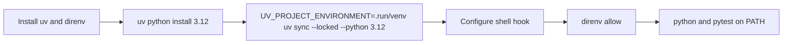

[Repository guidelines](AGENTS.md) · [Detailed agent instructions](.ai/AGENTS.md)

**EN** | [RU](docs/README.ru.md)

# AI / Data Job Salary Predictor — ML Zoomcamp 2026 Midterm

**Problem.** Predict indicative gross annual compensation in USD from role, seniority, employment type, employee and company geography, remote ratio, and company size. Treat the result as a statistical benchmark, not a guaranteed offer or a claim about Georgia B2B rates. This is an independent educational project.

**Data.** aijobs.net Global AI/ML/Data Science Salary Index, published under CC0: <https://github.com/foorilla/ai-jobs-net-salaries>. `scripts/download.py` downloads the CSV; `data/source.json` records its URL, byte count, and SHA256.

## Results from the checked run

Cleaning retained 71,890 rows; training used a deterministic sample of 50,000. The chronological split used years through 2023 for training, 2024 for validation, and 2025+ for test. Ridge regression with `alpha=1` won validation selection (MAE $49,934.15, RMSE $71,760.75). On the held-out test set it achieved **MAE $47,217.81** and **RMSE $67,735.40**. The median dummy validation baseline had MAE $57,526.48. Full candidate results are in [`models/metrics.json`](models/metrics.json).

EDA reports target distribution, missingness, median salary by experience, and permutation importance. The current Ridge analysis assigns the largest predictive contributions to job title, experience level, employee residence, and company location. Feature importance is model-specific and descriptive; correlated features can share or obscure importance. See [`reports/EDA.md`](reports/EDA.md), [`reports/salary_histogram.png`](reports/salary_histogram.png), and [`reports/feature_importance.png`](reports/feature_importance.png).

## Setup and run

For a clean macOS or Linux environment, install `uv` and `direnv` using their official installation instructions, then run this once from the repository root (Python 3.12, pinned in `settings/.python-version`):



```bash
uv python install 3.12
UV_PROJECT_ENVIRONMENT=.run/venv uv sync --locked --python 3.12
direnv allow
```

Configure your shell to load direnv (`direnv hook zsh` for zsh or `direnv hook bash` for bash; add the printed command to your shell's startup file and restart the shell). The repository's `.envrc` adds `.run/venv/bin` to `PATH`. From the repository, verify the commands are available:

```bash
python --version
pytest --version
```

Then run the project commands:

```bash
make data
make eda
make train
make test
```

Run focused quality gates with `make smoke`, `make unit`, or `make integration`. `make e2e` clones the configured Git remote into `.run/` and checks the clean-clone data, EDA, training, API, and Docker workflow. Configure a Git remote named `origin` and publish the branch first.

Start the API with `make serve`, then in another terminal check it:

```bash
curl -fsS http://localhost:8080/health
curl -fsS -X POST http://localhost:8080/predict \
  -H 'Content-Type: application/json' \
  -d @data/examples/sample-request.json
```

## Docker

The trained model artifact is tracked in Git, so a clean clone can build the service image:

```bash
docker build -f deploy/Dockerfile -t mlzc-salary .
docker run --rm -p 8080:8080 mlzc-salary
```

Or run `make docker-check` to build the image, start a temporary container, and smoke-test both endpoints. The original CSV is downloaded by `make data`; it is not committed.

## Data and modeling

Model inputs are `experience_level`, `employment_type`, `job_title`, `employee_residence`, `remote_ratio`, `company_location`, and `company_size`. `salary`, `salary_currency`, and `salary_in_usd` are excluded from features to prevent target leakage. `work_year` is used only to split observations. If the chronological split does not have enough rows in each partition, training uses a deterministic random 60/20/20 fallback and records it in the metrics JSON.

`src/mlzc_26_salaryan/train.py` compares a median `DummyRegressor`, two Ridge regularization strengths, and two Random Forest depths using validation MAE/RMSE. It selects by validation MAE, refits on train plus validation, and evaluates the holdout once. The notebook [`notebooks/salary-prediction.ipynb`](notebooks/salary-prediction.ipynb) documents cleaning, EDA, model selection, and feature importance. See the [docs index](docs/README.md) for detailed methodology and operation notes.

This historical survey data can have sample-selection and geographic bias; exact duplicate removal cannot identify repeated respondents. The model is unsuitable for individual compensation decisions.

## Optional Cloud Run deployment

The repository includes Cloud Run deployment instructions in [`docs/service-and-deployment.md`](docs/service-and-deployment.md). Deployment requires a configured GCP project and billing. No cloud deployment URL or live service is claimed by this repository.

## References

- [ML Zoomcamp project requirements](https://github.com/DataTalksClub/machine-learning-zoomcamp/tree/main/projects)
- [ML Zoomcamp midterm submission](https://courses.datatalks.club/ml-zoomcamp-2026/project/midterm)

**EN** | [RU](docs/README.ru.md)
