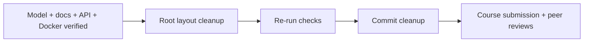

[EN](CHANGELOG.md) | [RU](CHANGELOG.ru.md)

# Changelog and current status

## Current status (BOF)

**Updated 2026-11-17.** Implementation checks 1–4 are complete: notebook code cells executed against the downloaded data; EDA includes held-out permutation importance; local API and Docker endpoints were smoke-tested; pytest passed. The root README and detailed docs are bilingual/localized, with Mermaid and text diagrams. Current checked metrics: Ridge(alpha=1), test MAE **$47,217.81**, RMSE **$67,735.40**.

**Next:** finish the requested root cleanup into `src/`, `notebooks/`, and `scripts/`; verify the relocated project; make the two requested commits; submit the final SHA and complete three peer reviews. No Cloud Run deployment is claimed.

## 2026-11-17 — Documentation and implementation review

- Added held-out permutation feature importance to the EDA report, CSV, and chart.
- Completed and executed the notebook's model comparison, holdout evaluation, and feature-importance cells.
- Verified `pytest -q` (1 passed), local `/health` and `/predict`, and `make docker-check`.
- Added detailed problem, data/EDA, modeling, and serving docs with data-flow, split, model-selection, and service diagrams.
- Added English/Russian README entry points and language-switch links. Detailed `docs/*.ru.md` translations are ignored by Git; the linked Russian project overview is tracked.

## 2026-11-16 — Reproducible salary-prediction MVP

- Downloaded the CC0 AI/ML salary dataset and recorded source URL, byte count, and SHA256 in `data/source.json`.
- Generated EDA, trained and evaluated candidate regression models, saved model and metrics, and implemented FastAPI inference.
- Added Docker packaging and local run instructions.
