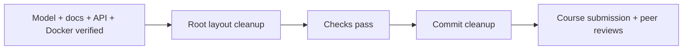

[EN](CHANGELOG.md) | [RU](CHANGELOG.ru.md)

# Changelog and current status

## Current status (BOF)

**Updated 2026-11-17.** Implementation checks 1–4 and the clean-clone e2e are complete. Tests passed: 3 smoke, 4 unit, 1 integration, and 1 origin-clone e2e. The e2e cloned `origin/main`, installed a fresh environment, downloaded data, generated EDA/model artifacts, and checked HTTP and Docker health/predict endpoints. Source is under `src/mlzc_26_salaryan/`, the notebook under `notebooks/`, and runtime files under ignored `.run/`. Current checked metrics: Ridge(alpha=1), test MAE **$47,217.81**, RMSE **$67,735.40**.

**Next:** record the pushed commit SHA in the course submission and complete three peer reviews. The canonical project directory is `mlzc-26-salaryan`; `mlzoomcamp-salary-minimal` remains a compatibility symlink. No Cloud Run deployment is claimed.

## 2026-11-17 — Project and runtime naming

- Renamed the Python distribution and import package to `mlzc-26-salaryan` / `mlzc_26_salaryan`.
- Moved local logs, notebook checkpoints, test caches, Python bytecode, and Matplotlib cache under ignored `.run/`.
- Updated Make, Docker, notebook, doctor script, tests, and localized documentation to the new package and file paths.
- Kept `mlzc-26-salaryan` as the canonical project directory and preserved the former name as a compatibility symlink.
- Organized settings and runtime files under `settings/`, `deploy/`, and `.run/`; `.dockerignore` remains a regular root file for Docker compatibility.
- Added smoke, unit, integration, and origin-clone e2e test levels.
- Moved the active environment and the preserved previous environment under `.run/venv` and `.run/venv-legacy`.

## 2026-11-17 — Documentation and implementation review

- Added held-out permutation feature importance to the EDA report, CSV, and chart.
- Completed and executed the notebook's model comparison, holdout evaluation, and feature-importance cells.
- Verified `pytest -q` (1 passed), local `/health` and `/predict`, and `make docker-check`.
- Added detailed problem, data/EDA, modeling, and serving docs with data-flow, split, model-selection, and service diagrams.
- Added English/Russian README entry points and language-switch links. Detailed `docs/*.ru.md` translations are ignored by Git; the linked Russian project overview is tracked.

## 2026-11-16 — Reproducible salary-prediction MVP

- Downloaded the CC0 AI/ML salary dataset and recorded source URL, byte count, and SHA256 in `data/source.json`.
- Generated EDA, trained and evaluated candidate regression models, saved model and metrics, and implemented FastAPI inference.
- Added Docker packaging and local run instructions.
