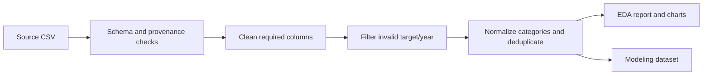

# Data, preparation, and EDA

## Source and provenance

The input is the aijobs.net Global AI/ML/Data Science Salary Index CSV, available under CC0 from the source repository. Run `make data` to download `data/salaries.csv`. The downloader checks for an expected minimum size and target column, then writes `data/source.json` with the source URL, downloaded byte count, and SHA256 digest. The CSV is ignored by Git; the documented downloader makes it reproducible without committing the full source file.

## Preparation

`model_utils.clean_data` selects the model contract fields, converts target/year to numeric, drops rows with missing target/year, filters salaries to the documented plausible range ($5,000–$1,000,000), fills missing feature categories with `UNKNOWN`, trims strings, and removes exact duplicate rows. Encoding is part of the model pipeline and is fitted on training data only.

## EDA outputs

Run `make eda`. The generated report and figures in `reports/` include:

- Raw and cleaned row counts, target median, and 10th/90th percentiles.
- Missing-value counts before cleaning.
- Median target by experience level.
- Salary histogram and permutation importance chart/table.

Permutation importance is measured by the increase in held-out MAE after shuffling one feature. The current report uses Ridge(alpha=1), the same deterministic sampling/split policy as training, a held-out sample of at most 2,000 rows, and two shuffles per feature. This is a model-specific predictive association. Correlated features can share importance, and importance is not causal evidence.

## Dataset caveats

The current downloaded file has 151,445 source rows and 71,890 rows after cleaning. None of the raw columns had missing values in the inspected snapshot. The salary histogram and group summaries are descriptive and can be affected by sample selection, geography, and year. The source may change; check `data/source.json` when comparing results across runs.
