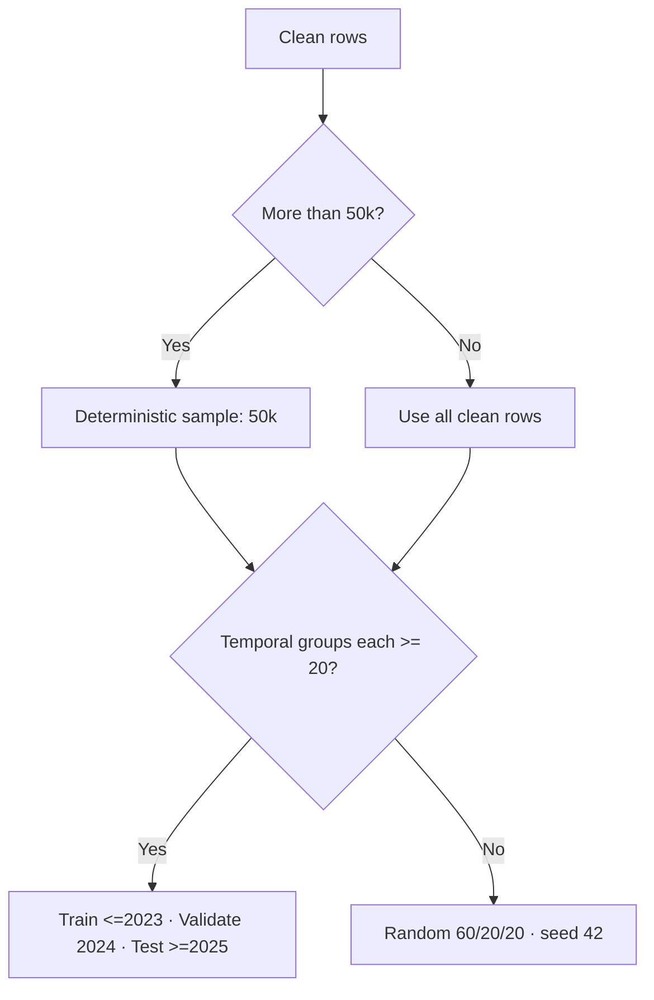
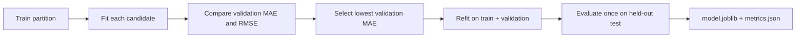

# Modeling and evaluation protocol

## Reproducible run

```bash
make setup
make data
make eda
make train
make test
```

`train.py` performs deterministic cleaning, sampling, split construction, validation comparison, final refitting, and artifact/report writing. The model is serialized to `models/model.joblib`; metrics and the split details are written to `models/metrics.json`.

## Split policy

The pipeline prefers a chronological split: years through 2023 for training, 2024 for validation, and 2025 or later for test. It uses this split only when all three groups have at least 20 rows. Otherwise it uses a deterministic random 60/20/20 split (`random_state=42`) and records the fallback in the report. When there are more than 50,000 clean rows, a deterministic 50,000-row sample is used for runtime control.



## Candidate models and selection

The validation candidates are:

1. Median `DummyRegressor` baseline.
2. Ridge regression with alpha 1 and alpha 20.
3. Random Forest with maximum depths 8 and 12.

Categorical inputs use one-hot encoding with unknown-category handling and a minimum frequency. Ridge and Random Forest models fit a log-transformed target and invert predictions for evaluation. The candidate with the lowest validation MAE is selected. The winner is refit on train plus validation; the untouched test set is evaluated after selection.



## Recorded run

For the checked data snapshot, cleaning retained 71,890 rows and the model used 50,000. The temporal split contained 4,122 training rows, 19,338 validation rows, and 26,540 test rows. Ridge(alpha=1) won with validation MAE $49,934.15 and RMSE $71,760.75. Holdout test MAE was $47,217.81 and RMSE was $67,735.40. These values are stored in `models/metrics.json`; rerunning against an updated upstream dataset can change them.

## Test interpretation

`pytest -q` uses a deliberately synthetic fixture to check training, model persistence, request validation, and API inference. It is an application regression test, not evidence of predictive quality. Model quality evidence comes from the real-data metrics and should be interpreted with the dataset limitations.
