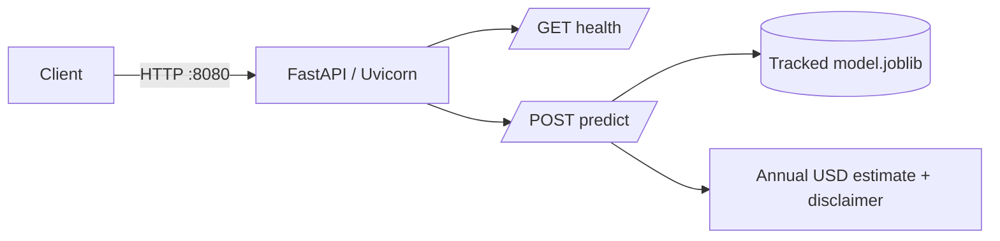

# Prediction service and deployment

## Local API

Run `make train` first if the model artifact is missing, then start the service:

```bash
make serve
```

The API exposes `GET /health` and `POST /predict`. The prediction request schema is demonstrated by `data/examples/sample-request.json`. The response contains an annual USD estimate and an educational-use disclaimer. Pydantic rejects invalid or missing fields, including `remote_ratio` outside 0–100.

In another terminal:

```bash
curl -fsS http://localhost:8080/health
curl -fsS -X POST http://localhost:8080/predict \
  -H 'Content-Type: application/json' \
  -d @data/examples/sample-request.json
```

## Docker

The Dockerfile installs pinned runtime requirements, copies the service code and tracked model artifact, and starts Uvicorn on the container port. A clean clone can build without downloading the training CSV:

```bash
docker build -t mlzc-salary .
docker run --rm -p 8080:8080 mlzc-salary
```

`make docker-check` builds the image, launches a temporary container on host port 18080, checks `/health`, posts `data/examples/sample-request.json` to `/predict`, then removes the container. The checked run built successfully and both endpoints returned successful responses.



The container is self-contained after the image is built:

```text
Docker image
├── Python 3.12 runtime
├── pinned requirements
├── FastAPI application
├── feature preprocessing contract
└── models/model.joblib
        │
        └── port 8080 → /health, /predict
```

## Optional Google Cloud Run

Cloud deployment requires an active GCP project, billing, `gcloud` authentication, and enabled Cloud Run/Cloud Build/Artifact Registry APIs. From the project root, build and deploy the container using the Cloud Run source workflow, then test the issued service URL with the same health and prediction requests. Public unauthenticated access can incur costs and expose the endpoint; configure access and spending limits deliberately. This repository documents the optional procedure but does not claim a live cloud deployment or URL.
